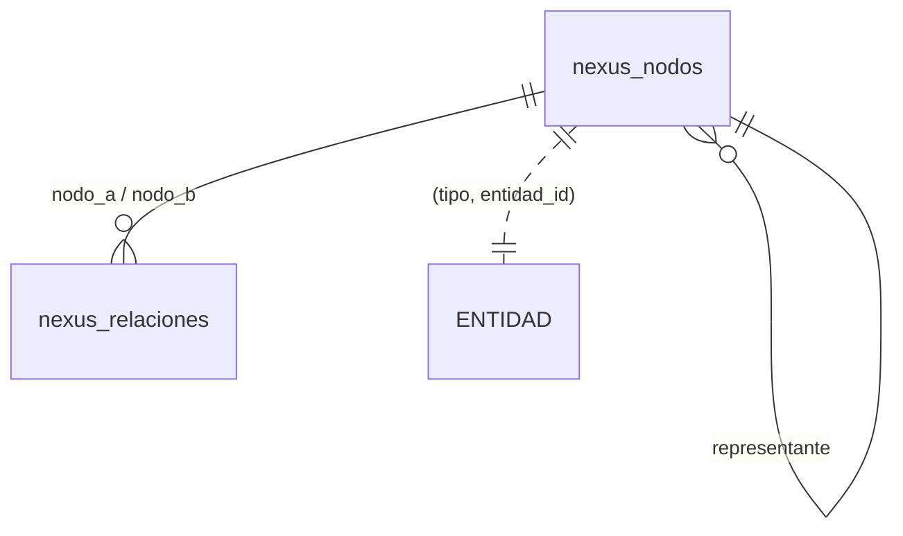
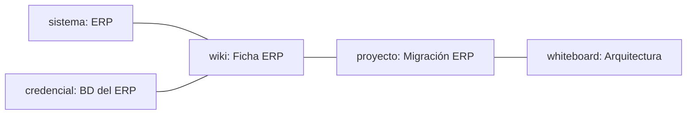
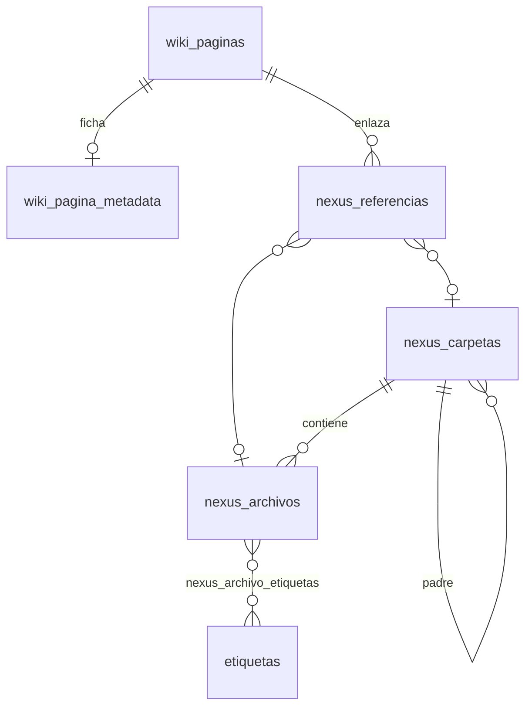

# Nexus — estructura de grafos y del catálogo

Este documento describe cómo guarda Nexus dos cosas:
- las **relaciones** entre entidades;
- el **catálogo documental**: fichas, archivos indexados y credenciales.

Va dirigido a IT y a desarrollo. Cómo ponerlo en marcha está en [NEXUS_PLAN_DE_ACCION.md](NEXUS_PLAN_DE_ACCION.md).

Código: `app_fastapi/db.py` (sección *nexus*), `app_fastapi/nexus/` (búsqueda, vista previa, cifrado) y `scripts/schema_app_tareas.sql`.

---

## 1. El grafo de relaciones

### Idea

Cualquier entidad puede relacionarse con cualquier otra **sin que una pertenezca a la otra**. Por ejemplo:
- un sistema (ERP) con su página de wiki;
- esa página con un proyecto de migración;
- el proyecto con una pizarra de arquitectura.

Esta capa va **además** de las claves foráneas normales (tarea → proyecto, etc.), no las sustituye.

La pregunta que responde es: **¿qué está relacionado con esto, directa o indirectamente?** Para responderla rápido se usa una estructura de **conjuntos disjuntos** (*Union-Find*). Las entidades conectadas forman un **grupo**, y cada grupo tiene un nodo **representante**. Dos entidades están relacionadas si y solo si sus nodos tienen el mismo representante.

### Tipos de entidad (nodos)

`NEXUS_TIPOS` en `db.py`:

| Tipo | Tabla | Se crea el nodo al… |
|---|---|---|
| `proyecto` | `proyectos` | crear el proyecto |
| `sistema` | `sistemas` | crear el sistema (Configuración) |
| `empresa` | `empresas` | crear la empresa (Configuración) |
| `wiki_pagina` | `wiki_paginas` | crear la página |
| `nota` | `notas` | crear la nota |
| `whiteboard` | `whiteboards` | crear la pizarra |
| `credencial` | `credenciales` | guardar la credencial |

El nodo se crea **en la misma transacción** que la entidad (variantes `_nexus_*(cur, …)`). Al borrar la entidad, su nodo se elimina antes (`_nexus_eliminar_nodo`).

### Tablas

```
nexus_nodos        id · tipo · entidad_id · representante · creado_en
                   UNIQUE (tipo, entidad_id)       -- un nodo por entidad
nexus_relaciones   id · nodo_a · nodo_b · creado_en
                   UNIQUE (nodo_a, nodo_b)         -- arista no dirigida, guardada con nodo_a < nodo_b
nexus_historial    grupo_nodos · representante_anterior · representante_nuevo · motivo · creado_en
```



`entidad_id` **no** es una clave foránea: un solo par de columnas apunta a siete tablas distintas. La coherencia la mantienen los propios `crear_*`/`eliminar_*` y, como red de seguridad, `nexus_sincronizar()` (ver §4).

### Operaciones

| Función | Qué hace | Coste |
|---|---|---|
| `nexus_crear_nodo(tipo, id)` | Nodo nuevo, que es su propio representante (grupo de 1). Si ya existe, lo devuelve. | 1 consulta |
| `nexus_relacionar((tipo, id), (tipo, id))` | Crea la arista. Si los nodos estaban en grupos distintos, **une** los grupos (ver abajo). | proporcional al grupo menor |
| `nexus_relacionados(tipo, id)` | Todo el grupo menos la propia entidad. Marca `directo` si hay arista explícita y `es_representante`. | 1 consulta por índice |
| `nexus_representante(tipo, id)` | Id del representante del grupo. | 1 consulta |
| `nexus_eliminar_nodo(tipo, id)` | Quita el nodo y sus aristas. Si era el representante, **promueve** a otro. | proporcional al grupo |
| `nexus_sincronizar()` | Crea los nodos que falten y quita los huérfanos. Es idempotente. | recorre las 7 tablas |

**Unión por tamaño.** Al unir dos grupos, todos los nodos del grupo **menor** pasan a tener como representante el del **mayor** (con empate, se queda el del primer argumento). El cambio queda en `nexus_historial`. Como siempre se mueve la mitad pequeña, cada nodo cambia de representante como mucho log₂(n) veces en toda su vida.

A diferencia del Union-Find clásico, aquí no hay *compresión de caminos*: cada nodo apunta **directamente** a su representante, sin cadenas intermedias. Así, consultar "¿qué está relacionado?" es un único `WHERE representante = ?` con índice. El coste se paga al unir, que es mucho menos frecuente que consultar.

**Promoción al eliminar al representante.** El grupo no se queda sin cabeza. Se elige el nodo con **más aristas hacia el resto del grupo**; si hay empate, el más antiguo. Queda registrado en `nexus_historial`.

### Ejemplo



Las cinco entidades forman un grupo. Abrir cualquiera de ellas muestra las otras cuatro como "relacionado", y `directo` distingue las aristas explícitas (ERP ↔ Ficha) de las indirectas (ERP ↔ Arquitectura).

### Limitaciones conocidas (por diseño)

- **Los grupos no se separan.** Si se borra el nodo que unía dos partes de un grupo, las dos partes siguen en el mismo grupo, aunque ya no haya un camino entre ellas. Un Union-Find no admite "des-unir". Separarlas exigiría recalcular las componentes conexas a partir de `nexus_relaciones`, y eso no se hace (todavía).
- No hay **tipos de relación** ("depende de", "documenta a"…): todas las aristas son iguales y sin dirección.
- **Hoy no existe pantalla para crear relaciones a mano**: solo se crean por código. Es una de las tareas del plan de acción.

---

## 2. El catálogo documental



| Pieza | Tabla | Qué es |
|---|---|---|
| **Ficha** | `wiki_paginas` + `wiki_pagina_metadata` | Una página de wiki que describe un sistema o servicio. Sus campos estructurados son alias, código, tecnologías, estado y rol. Nexus muestra como **resumen** lo que hay en la página antes del título "Info para desarrolladores", y como **info técnica** lo que viene después. Una página de wiki sin fila de metadatos es una página normal, no una ficha. |
| **Carpeta / Archivo** | `nexus_carpetas`, `nexus_archivos` | Lo que hay en una carpeta (local o de red), **indexado en su sitio**: Nexus no copia los ficheros, guarda su ruta, sus fechas y su **texto** (`contenido_plano`), que es lo que busca el índice FULLTEXT. Los carga `scripts/nexus_indexar.py`. |
| **Referencia** | `nexus_referencias` | "Este archivo o carpeta pertenece a esta ficha". Es lo que hace que un archivo aparezca dentro de la tarjeta de su sistema. |
| **Credencial** | `credenciales` | Usuario y secreto **cifrado con AES-256-GCM** (`nexus/cripto.py`), con una clave derivada por PBKDF2 de una contraseña que **no se guarda**. Cuelga de una ficha mediante una arista del grafo (nodo de tipo `credencial`). |
| **Etiquetas** | `etiquetas`, `nexus_*_etiquetas` | Etiquetado libre de archivos y carpetas. Hoy la búsqueda no las usa. |
| **Registro de búsquedas** | `nexus_busquedas_log` | Qué se busca y cuántos resultados da. Sirve para detectar qué falta documentar. |

**Archivos "técnicos" sin curar.** Un archivo con `rol = 'tecnico'` y **sin** ninguna referencia (código, configuración, logs que nadie ha asociado a una ficha) no sale en la búsqueda normal, solo en la **búsqueda dev**. Cuando se enlaza a una ficha, pasa a la búsqueda normal.

**Temas curados (`TOPICS`, `nexus/search.py`).** Una palabra clave (p. ej. "backup") puede llevar a una lista **fija** de fichas en vez de a una búsqueda libre. Viene vacía: la rellena cada instalación.

---

## 3. Cómo se busca

1. **Fichas**: `LIKE` sobre título, alias, código y tecnologías. Además se busca cada palabra dentro del texto de la página. Cada ficha se completa con sus archivos, sus credenciales (solo las de arista directa) y lo relacionado en el grafo.
2. **Archivos**: `LIKE` sobre el nombre más `MATCH … AGAINST` en modo booleano con prefijos sobre `(nombre, descripcion, contenido_plano)`. Se excluyen los técnicos sin curar.
3. **Wiki y tareas** de la app, aparte.

Los resultados se fusionan sin duplicados. La vista previa de un archivo (PDF, imagen, texto) se genera al vuelo desde su ruta y se guarda en `.cache/nexus_previews`.

---

## 4. Mantenimiento

- **`db.nexus_sincronizar()`** repara el grafo si alguien borró filas por SQL directo o por un `ON DELETE CASCADE`. Es seguro lanzarlo cuando se quiera, y los tests lo lanzan al terminar.
- **Reindexar** una carpeta: se vuelve a ejecutar `scripts/nexus_indexar.py <carpeta> --limpiar`. Actualiza por ruta y quita lo que ya no existe.
- **Cambio de servidor de ficheros**: las rutas son absolutas (`ruta_completa`), así que hay que reindexar desde la nueva ruta. Las fichas y referencias se mantienen si la ruta *relativa* no cambia.
